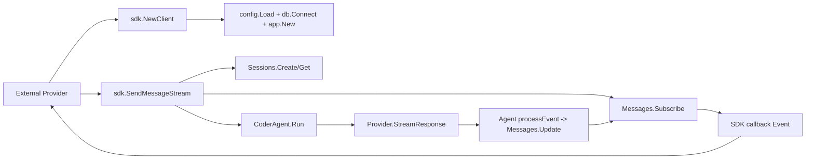

# OpenCode Go SDK (Embedded Mode)

This package exposes OpenCode as a Go library so external projects can call it
directly instead of invoking the `opencode` binary.

## Goals

- Direct Go API invocation (no shell/system command call).
- Reuse OpenCode native pipeline: session, message persistence, tools, model routing.
- Stream all message events, including tool calls and tool results.

## Directory Structure

- `sdk/doc.go`: package-level documentation.
- `sdk/client.go`: exported SDK client and stream event model.

## Architecture

1. Consumer initializes `sdk.Client` with workspace/config options.
2. SDK bootstraps OpenCode internals:
   - `config.Load` to load `.opencode.json`
   - `db.Connect` to open sqlite and migrations
   - `app.New` to wire services (`Sessions`, `Messages`, `CoderAgent`, `Permissions`)
3. Consumer calls `SendMessageStream`.
4. SDK subscribes to `Messages` pubsub and starts `CoderAgent.Run`.
5. SDK emits callbacks for:
   - message created/updated
   - assistant text/thinking deltas
   - full message snapshot including tool calls/results
   - completion/cancel/error

## Call Flow

## Consumer Contract

Use `Event.Message` as the authoritative snapshot. It always includes:

- message role (`user` / `assistant` / `tool`)
- assistant text and reasoning
- tool call list (`id`, `name`, `input`, `finished`)
- tool result list (`tool_call_id`, `content`, `is_error`, `metadata`)

This allows host applications to build a complete timeline without re-querying DB.
